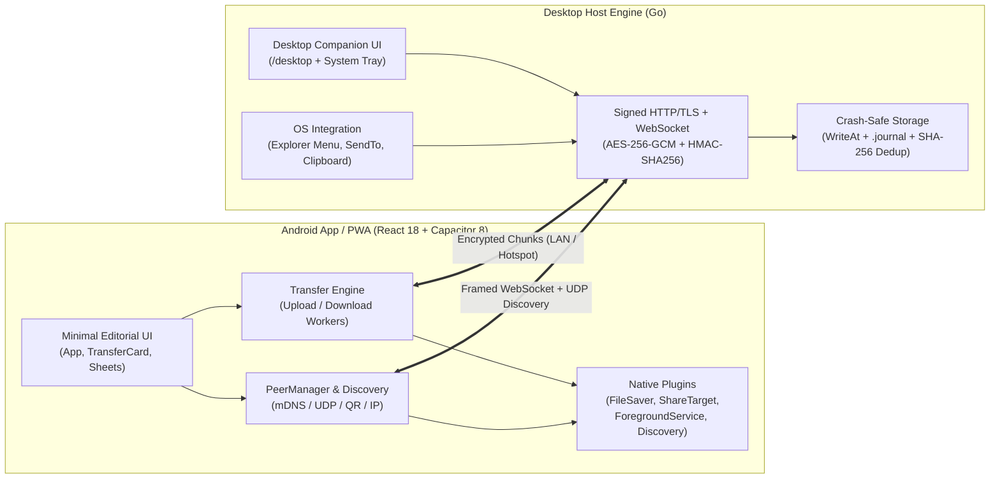

# P2P Link

<p align="center">
  
</p>

<p align="center">
  <strong>Fast, private, zero-cloud file transfer, text sharing, and clipboard sync between your Windows PC and Android phone over local Wi-Fi or hotspot.</strong>
</p>

<p align="center">
  <a href="https://p2p-nine-iota.vercel.app"><strong>🌐 Official Web Download</strong></a> · 
  <a href="https://github.com/Ishaan488/p2p/releases/latest"><strong>📦 Latest Release</strong></a> · 
  <a href="LICENSE"><strong>📄 MIT License</strong></a>
</p>

<p align="center">
  <a href="LICENSE"></a>
  <a href="https://github.com/Ishaan488/p2p/releases"></a>
  <a href="https://go.dev/"></a>
  <a href="https://react.dev/"></a>
  <a href="https://www.typescriptlang.org/"></a>
  <a href="https://capacitorjs.com/"></a>
  
  
</p>

---

## Overview

**P2P Link** is a lightweight, zero-cloud local file transfer and device continuity tool designed as a fast, reliable, cross-platform alternative to AirDrop and Quick Share.

Everything travels directly between your devices over your local Wi-Fi network or mobile hotspot using authenticated **AES-256-GCM** end-to-end encryption. There are no accounts, no file-size limits, no cloud relays, and zero quality compression on photos or 4K videos.

---

## For Everyday Users — 30-Second Setup

You do **not** need to use a terminal or type IP addresses. P2P Link pairs just like WhatsApp Web:

| Step | What to do |
| :--- | :--- |
| **1. Install on PC** | Double-click **`Install-P2P-Link.bat`** (Windows). It automatically configures Windows Firewall, adds **"Send via P2P Link"** to your right-click menu, creates a **P2P Link** Desktop shortcut, and opens the Desktop Pairing Dashboard. |
| **2. Install on Phone** | Install **`dist-apk/p2p-release.apk`** on your Android phone (or open [`site/index.html`](site/index.html) for the guided download page). |
| **3. Scan QR Code** | Open **P2P Link** on your phone, tap **Scan QR Code**, and point your camera at the QR code shown on your PC screen. |

Once paired, your phone and PC remember each other and reconnect automatically whenever they are on the same Wi-Fi network.

### Everyday Ways to Send
- **From Phone to PC**:
  - Open **P2P Link** and tap **Send files** (Photos & Videos, Documents, Audio, Folder) or type/paste text in the composer.
  - Or share directly from **any Android app** (Gallery, Files, Browser) via the native **Share $\rightarrow$ P2P Link** sheet.
- **From PC to Phone**:
  - **Right-click any file or folder** in Windows Explorer and click **Send via P2P Link**.
  - Or use the **Desktop Companion Window** (`http://localhost:8080/desktop`) to send files, folders, or text with one click.

---

## Key Capabilities

### 1. Minimal, Content-First Mobile Experience
- **Monochromatic Charcoal Design System**: Crafted with a distraction-free monochromatic charcoal palette (`#101010` canvas, brightness-layered `#181818` / `#202020` surfaces, stark bone `#E5E5E5` primary actions, and semantic status accents) with full dark and light theme support.
- **Inline Media & Code Previews**: View images in a zoomable lightbox, play received videos and audio inline, preview PDFs, and inspect syntax-highlighted code snippets with one-tap copy.
- **Native Android Integration**:
  - Full **Android Share Target** (`ACTION_SEND` / `ACTION_SEND_MULTIPLE`) with atomic stream spooling so shared photos and videos from any provider arrive bit-for-bit intact.
  - Direct **MediaStore Downloads** integration with automatic `MediaScannerConnection` indexing so downloaded videos and images immediately appear in your Gallery and video players with thumbnails.
  - **Foreground Transfer Service** that keeps multi-gigabyte transfers running smoothly when the screen is off.

### 2. Line-Rate Transfer Engine
- **$\mathcal{O}(1)$ Memory Footprint**: Streams multi-gigabyte files (tested up to 60 GB+) using adaptive chunking (`256 KiB` to `4 MiB`) and positional random-access `WriteAt` / `FileChannel` I/O. Memory stays flat regardless of file size.
- **Parallel Chunk Workers**: Concurrent encrypted chunk streams saturate 5 GHz / Wi-Fi 6 links at **80–120+ MB/s**.
- **Pre-Flight SHA-256 Deduplication**: Checks whether the destination already holds an identical file by SHA-256 digest before transmitting payload bytes.
- **Crash-Consistent Resumption**: Interrupted transfers resume from the exact unreceived chunk using write-ahead chunk journals (`.journal`) on desktop and persisted chunk bitmaps on mobile.

### 3. End-to-End Security
- **Cryptographic Pairing**: QR pairing derives a 256-bit device key via **HKDF-SHA256** without transmitting the pairing secret over the network.
- **Authenticated Sessions**: Every session exchanges fresh nonces and proves identity via mutual **HMAC-SHA256** before opening a transport channel.
- **Per-Chunk AES-256-GCM**: Every HTTP request, WebSocket frame, and file chunk is sealed with a unique 96-bit nonce and bound to its transfer ID and chunk index via Additional Authenticated Data (AAD), preventing replay or chunk-swapping attacks.
- **Sensitive Clipboard Protection**: Automatic client- and host-side filters skip syncing payment cards (Luhn validation), PEM private keys, JWTs, and API tokens (`ghp_`, `sk-`, `AKIA`, etc.).

### 4. Multi-Device Mesh
- **Multiple Paired Computers**: Pair your phone with your home desktop, work laptop, and media server simultaneously.
- **Zero-Config Discovery**: Hybrid **mDNS (`_p2plink._tcp.local.`)** and **UDP broadcast (`:8089`)** discovery detects online desktops automatically and wakes connections when switching networks.

---

## Architecture



---

## Repository Structure

```text
.
├── Install-P2P-Link.bat          # 1-click Windows installer (Firewall, Explorer menu, Desktop shortcut)
├── Start P2P.bat                 # Quick launcher for Windows desktop host
├── Makefile                      # Cross-platform build, test, and verification targets
├── site/
│   └── index.html                # Standalone 1-page user download & visual onboarding site
├── scripts/
│   ├── build-release-apk.bat     # Builds & signs production Android APK (dist-apk/p2p-release.apk)
│   ├── build-apk.bat             # Builds debug Android APK (dist-apk/p2p-debug.apk)
│   ├── build-desktop.bat         # Compiles embedded Go desktop binary (p2p.exe)
│   └── install-phone.bat         # Installs APK to USB-connected Android device via ADB
├── apps/
│   ├── cli/                      # Go desktop host engine
│   │   ├── main.go               # Server lifecycle, flags, TLS, graceful shutdown
│   │   ├── desktop_ui.go         # Visual Desktop Companion & QR Pairing dashboard (/desktop)
│   │   ├── auth.go               # Pairing, HKDF session keys, HMAC signing, AES-GCM cipher
│   │   ├── upload.go             # Chunk receiver, write-ahead journal, atomic finalization
│   │   ├── download.go           # Chunk server, range streaming, folder zip streaming
│   │   ├── transfer_state.go     # In-flight transfer state & crash recovery
│   │   ├── discovery.go          # mDNS + UDP broadcast announcement & /discover endpoint
│   │   ├── clipboard*.go         # Cross-platform clipboard sync & sensitive content filter
│   │   ├── local_ipc.go          # Loopback IPC for Explorer right-click & CLI --send handoff
│   │   └── os_integration_*.go   # Win32 system tray, Explorer context menu, autostart
│   └── mobile/                   # React 18 + TypeScript + Capacitor 8 Android client
│       ├── src/
│       │   ├── App.tsx           # Workspace, discovery screen, composer, share & download orchestration
│       │   ├── index.css         # Design tokens, editorial feed layout, dark/light themes
│       │   ├── components/       # TransferCard, Sheet, DevicesSheet, MediaViewer, Toast, viewers
│       │   └── lib/              # api, crypto, uploads, downloads, chunkLayout, mime, peerManager
│       └── android/              # Capacitor Android project & Java native plugins
│           └── app/src/main/java/com/example/app/
│               ├── FileSaverPlugin.java         # Positional MediaStore & Downloads streaming
│               ├── ShareTargetPlugin.java       # Android Share Sheet receiver & file spooler
│               ├── DiscoveryPlugin.java         # Native UDP broadcast & mDNS discovery
│               └── ForegroundServicePlugin.java # Background transfer notification service
└── docs/                         # Protocol spec, security model, architecture, and benchmarks
```

---

## Building From Source

### Prerequisites
- **Desktop Host**: [Go 1.22+](https://go.dev/dl/) and [Node.js 18+](https://nodejs.org/)
- **Android APK (Optional)**: JDK 17+ (or JDK 22) and Android SDK (`ANDROID_HOME`)

### 1. Build the Desktop Binary (`p2p.exe` / `p2p`)
```bash
# Windows
scripts\build-desktop.bat

# macOS / Linux
./scripts/build-desktop.sh
# or:
make web build
```

To cross-compile standalone binaries for Windows, macOS (Intel & Apple Silicon), and Linux (`amd64` & `arm64`):
```bash
make web cross
# Outputs to dist-bin/
```

### 2. Build the Signed Production Android APK (`dist-apk/p2p-release.apk`)
No Android Studio is required. Run:
```bash
# Windows — Signed Production Release APK
scripts\build-release-apk.bat

# Windows — Debug APK
scripts\build-apk.bat

# Install directly to a connected Android phone over USB
scripts\install-phone.bat
```

---

## Desktop CLI & Flags Reference

While everyday users can use the **Desktop Companion UI** (`http://localhost:8080/desktop`) and the **Windows System Tray**, power users have full CLI control:

### Launch Flags
| Flag | Description |
| :--- | :--- |
| `--desktop` | Open the visual Desktop Companion & QR Pairing window on startup |
| `--open` | Open the web UI in the default browser on startup |
| `--port <n>` | Port to listen on (default `8080`; auto-increments if busy) |
| `--send <path>` | Send a file or folder via the running instance (or start and queue) |
| `--to <device>` | Target a specific paired device name, alias, or ID with `--send` |
| `--tls` | Enable HTTPS/WSS with self-signed TLS and QR certificate fingerprint pinning |
| `--bandwidth <MB/s>` | Cap transfer bandwidth in MB/s (`0` = unlimited) |
| `--install-context-menu` | Register *"Send via P2P Link"* in the Windows Explorer right-click menu |
| `--autostart on\|off` | Enable or disable automatic background startup on login |

### Interactive Terminal Commands (`p2p>`)
| Command | Action | Example |
| :--- | :--- | :--- |
| `send <path> [--to <peer>]` | Send a file or folder to connected device(s) | `send "C:\Videos\demo.mp4"` |
| `msg <text> [--to <peer>]` | Send a text message or link | `msg "https://example.com"` |
| `devices` | List paired devices and connection status | `devices` |
| `trust <device>` | Toggle auto-accept for uploads from a device | `trust "Pixel 8"` |
| `unpair <device>` | Remove a paired device and revoke its key | `unpair "Pixel 8"` |
| `pair` | Print a fresh pairing QR code in the terminal | `pair` |
| `history` | Show recent sent and received transfers | `history` |
| `status` | Display uptime, memory usage, and active transfers | `status` |
| `open` | Open the Desktop Companion window in your browser | `open` |

---

## Testing & Verification

Run the full verification suite before releasing:

```bash
# 1. Mobile TypeScript & Vitest Unit Suite (165+ tests)
npm --prefix apps/mobile test -- --run
npm --prefix apps/mobile run build

# 2. Desktop Go Test Suite (Unit, Integration, Crash Recovery, Security, Fuzzing)
cd apps/cli && go test ./...
```

---

## Troubleshooting for Everyday Users

### "Could not reach PC" / Devices Not Connecting
1. **Check Same Wi-Fi**: Make sure both your phone and computer are connected to the same Wi-Fi network (and that your phone isn't using mobile data while your PC is on Wi-Fi).
2. **College, Office, or Hotel Wi-Fi (Client Isolation)**: Public Wi-Fi networks often block devices from talking directly to each other.
   - **Instant Fix**: Turn on your **Phone's Wi-Fi Hotspot** (you can even turn Mobile Data off so it uses zero data!), connect your laptop to your phone's hotspot, and scan the QR code. Transfers will run at maximum speed (80–120 MB/s).
3. **Windows Firewall**: Run `Install-P2P-Link.bat` or `Start P2P.bat` once and click **Yes** when Windows asks to allow P2P Link through the firewall.

### Keeping Large Transfers Running with Screen Off
- P2P Link runs a native Android Foreground Service during active transfers. On devices with aggressive OEM battery savers (Xiaomi HyperOS/MIUI, Samsung OneUI, Realme/Oppo ColorOS), allow **Notifications** and set battery usage to **Unrestricted** in App Info if you transfer multi-gigabyte files with the screen locked.

---

## License

Distributed under the [MIT License](LICENSE).
