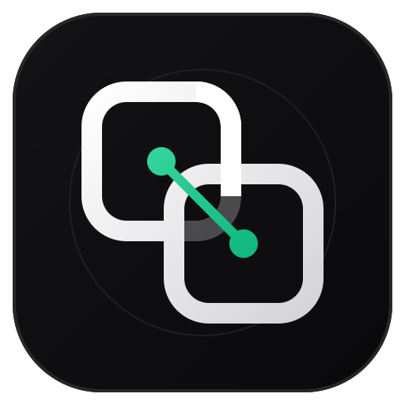

# P2P Link

<p align="center">
  
</p>

<p align="center">
  <strong>Ultra-fast, encrypted peer-to-peer file transfer, real-time messaging, and clipboard synchronization across Desktop and Mobile on local Wi-Fi.</strong>
</p>

<p align="center">
  <a href="LICENSE"></a>
  <a href="https://go.dev/"></a>
  <a href="https://react.dev/"></a>
  <a href="https://www.typescriptlang.org/"></a>
  <a href="https://vitejs.dev/"></a>
  <a href="https://capacitorjs.com/"></a>
  
  
  
</p>

---

## 📖 Overview

**P2P Link** is a lightweight, high-performance, and privacy-respecting local file transfer platform designed as an open-source, cross-platform alternative to Apple AirDrop, Google Quick Share, and Snapdrop. 

It pairs a high-throughput **Go host engine** on desktop with a polished **Obsidian + Soft Lavender** mobile client running on React 18, TypeScript, and Capacitor for Android. All data moves strictly over your local Wi-Fi network with end-to-end authenticated encryption (AES-256-GCM) — no external servers, cloud storage, accounts, or internet connectivity required.

---

## ✨ Highlights & Architecture

### 🎨 Obsidian + Soft Lavender Design Language
- **Calm, Premium Aesthetic:** Purpose-built palette centered on Obsidian (`#17161D`), deep elevated surfaces (`#201E27`), and Soft Lavender (`#A995D5` / `#7E66AC`) interactive accents.
- **Dual-Theme Support:** Automatic and manual switching between Dark and Light modes (`#F6F4F8`) with verified **WCAG AA contrast compliance** (4.83:1 on light-theme CTAs, 6.77:1 on dark-theme CTAs).
- **Dynamic Android Status Bar:** Synchronizes `<meta name="theme-color">` dynamically to match the active theme, integrating seamlessly with Android system bars.
- **Tactile Touch Targets:** All interactive controls (buttons, pills, icons) enforce a minimum **44×44px hit-area** via centered pseudo-element expanders.
- **Scroll Clearance:** Trailing `.activity-scroll-spacer` guarantees that the final items in the transfer stream scroll completely clear of the floating bottom toolbar with comfortable breathing room.

### ⚡ Line-Rate Transfer Engine
- **Flat $\mathcal{O}(1)$ Memory Scaling:** Streams multi-gigabyte files (tested up to 60GB+) using adaptive chunking (256 KB to 4 MB) with random-access `WriteAt` I/O. Memory usage remains flat ($< 15\text{ MB}$) regardless of file size.
- **Pre-Flight SHA-256 Deduplication:** Incremental hash verification checks if a file already exists on the destination before streaming payload bytes. Duplicates transfer in 0 milliseconds and consume 0 bytes of network bandwidth.
- **Parallel Worker Streams:** Concurrent chunk streaming saturates local Wi-Fi bandwidth, delivering speeds of 80–120+ MB/s on modern 5 GHz / Wi-Fi 6 connections.

### 🛡️ Crash-Consistent Chunk Recovery & Security
- **Resilient Transfer Resumption:** Interrupted transfers resume deterministically from the exact last verified chunk via manifest tracking and per-chunk digest validation.
- **Atomic Finalization:** Completed files are verified, recorded in the transfer history, and atomically moved into destination directories with collision-free naming, preventing partial-write corruption.
- **End-to-End Cryptography:** Authenticated AES-256-GCM encryption with HKDF-SHA256 key derivation. Unauthenticated HTTP connections on local Wi-Fi are automatically protected via a pure-JS noble-ciphers fallback.
- **Path Traversal Protection:** Defends against directory escapes (`../../`), Zip Slip exploits in folder transfers, and defangs Windows reserved device names (`CON`, `PRN`, `AUX`, `NUL`, etc.).

### 📱 Android Integration
- **Zero Android Studio Requirement:** The entire Android APK is compiled and packaged via standard CLI commands using Gradle Wrapper (`gradlew assembleDebug`).
- **Android Share Target:** Send photos, videos, documents, or text directly from any Android app using the native "Share → P2P Link" intent.
- **Background Transfers:** Transfers continue uninterrupted even when the screen is turned off or the app is minimized via the native Android Foreground Service.
- **Hardware Back Button:** Fully integrated hardware back-button stack across all 7 modals, sheets, and image lightboxes.
- **USB Live-Reload Workflow:** Direct ADB port forwarding (`localhost:5173`) enables instant on-device hot-reloading during development without reinstalling APKs.

---

## 🚀 Quick Start

### Prerequisites
- **Desktop:** [Go 1.21+](https://go.dev/dl/) installed.
- **Mobile Build (Optional):** [Node.js 18+](https://nodejs.org/) & Java JDK 17+ (for compiling the Android APK).

---

### Desktop (Go Host Engine)

#### 1. Launch the Server
```bash
# Windows (One-Click)
Start P2P.bat

# Or compile and run directly:
cd apps/cli
go run .
```

The desktop host starts immediately (< 10ms) and presents an interactive prompt along with a pairing QR code:

```
===================================================
  P2P Link — Host Engine (Port 8080)
===================================================
  Wi-Fi IP : 192.168.1.15:8080
  Status   : Ready for connections
===================================================

p2p> 
```

#### 2. Desktop CLI Commands

| Command | Action | Example |
| :--- | :--- | :--- |
| `send <path>` | Send file or folder to all connected devices | `send "C:\Photos\vacation.jpg"` |
| `send <path> --to <peer>` | Target a specific device | `send "report.pdf" --to "Pixel 8"` |
| `> <path> [--to <peer>]` | Fast shorthand for sending | `> "clip.mp4" --to Laptop` |
| `msg <text> [--to <peer>]` | Send text message or URL | `msg "https://github.com" --to Pixel` |
| `devices` | List paired devices and online status | `devices` |
| `trust <device>` | Auto-accept transfers from device | `trust "Pixel 8"` |
| `unpair <device>` | Revoke pairing and disconnect peer | `unpair "Pixel 8"` |
| `history` | View recent transfer history | `history` |
| `status` | Show system uptime, RAM, active transfers | `status` |
| `pair` | Show QR code and pairing token | `pair` |
| `open` | Open desktop web UI in default browser | `open` |

---

### Mobile (Android App & PWA)

#### Option 1: Native Android App (Recommended)
1. **Compile the APK (No Android Studio required):**
   ```bash
   # Windows
   scripts\build-apk.bat

   # Linux / macOS
   ./scripts/build-apk.sh
   # or: make apk
   ```
2. **Install to Connected Phone via ADB:**
   ```bash
   # Windows
   scripts\install-phone.bat

   # Linux / macOS
   ./scripts/install-phone.sh
   # or: make install
   ```
3. Open **P2P Link** on your phone, tap **Scan QR Code**, and point your camera at the desktop terminal.

#### Option 2: Progressive Web App (PWA)
1. Open your mobile browser (Chrome, Safari, Firefox) and navigate to the IP shown in your desktop terminal (e.g., `http://192.168.1.15:8080`).
2. Scan the terminal pairing QR code or enter the pairing code.
3. Tap **Add to Home Screen** to install as a standalone OLED web app.

---

## 🧩 Component Architecture

```
apps/mobile/src/
├── App.tsx                     # Main application shell & WebSocket transport orchestrator
├── index.css                   # Obsidian + Soft Lavender tokens, responsive layout, 44px hit-expanders
├── components/
│   ├── ConnectionScreen.tsx    # Standby screen, Wi-Fi LAN discovery, inline IP editor, QR scanner
│   ├── TransferActionPanel.tsx # 6-category action strip (Photos, Videos, Audio, Docs, Folder, Paste)
│   ├── TransferCard.tsx        # History item with Received/Sent badges, 16:9 previews, 360px protection
│   ├── BatchProgress.tsx       # Shimmer progress bar, MB/s telemetry, remaining time, pause/cancel
│   ├── PreferencesModal.tsx    # Grouped device settings (Local Mobile vs Remote Desktop)
│   ├── SendTextModal.tsx       # Instant text & URL sharing bottom sheet with clipboard paste
│   ├── ConfirmationDialog.tsx  # Semantic confirmation dialog with severity badges
│   ├── MediaViewer.tsx         # Fullscreen image lightbox with zoom and pan
│   ├── VideoPlayer.tsx         # Custom inline & fullscreen video player
│   ├── AudioPlayer.tsx         # Waveform audio playback HUD
│   ├── PdfViewer.tsx           # Inline PDF viewer
│   ├── CodeViewer.tsx          # Syntax-highlighted code snippet viewer
│   └── BrandLogo.tsx           # Animated SVG identity logo
└── lib/
    ├── api.ts                  # HTTP API client, pairing endpoints, error handling
    ├── transport.ts            # Framed WebSocket transport with sequence counters
    ├── crypto.ts               # WebCrypto + pure-JS noble-ciphers HKDF/AES-GCM
    ├── uploads.ts              # Adaptive chunk streaming & worker queue
    ├── downloads.ts            # Streamed download saver & filesystem bridge
    ├── discovery.ts            # mDNS & UDP LAN device discovery
    ├── shareTarget.ts          # Android native intent receiver
    └── backButton.ts           # Hardware back-button stack manager
```

---

## 🛠️ Developer & Live-Reload Workflow

To iterate on the mobile UI without repeatedly rebuilding and reinstalling APKs, use the automated ADB Live-Reload runner:

```bash
npm --prefix apps/mobile run dev:live
```

This workflow automatically:
1. Detects connected Android devices via ADB.
2. Forwards port 5173 (`adb reverse tcp:5173 tcp:5173`).
3. Starts the Vite dev server with Hot Module Replacement (HMR).
4. Directs your phone's WebView to hot-reload changes within milliseconds.

---

## 🧪 Testing & Quality Assurance

### Go Test Suite (Desktop & Protocol)
```bash
cd apps/cli
go test -v ./...
```
- **Crash Recovery:** `TestRestartTransferRecovery` validates chunk resumption after process kills.
- **Multi-Device Targeting:** `TestPhase4_MultiDeviceTargeting` ensures isolated message delivery.
- **Content Deduplication:** `TestPhase4_ContentDeduplication` verifies zero-byte transmission for identical files.
- **Fuzzing Suite:** Continuous fuzz testing on filename sanitizers, chunk AAD bindings, and request signatures.

### Mobile Build & TypeScript Verification
```bash
npm --prefix apps/mobile run build
```
Validates zero TypeScript compile errors (`tsc`) and bundles production assets with Vite.

---

## 🌐 Network Troubleshooting

### Campus / Enterprise Wi-Fi (AP Client Isolation)
Public and university Wi-Fi networks typically enable **AP Client Isolation**, which blocks devices on the same subnet from seeing each other.
- **Fix 1 (Direct QR Pairing):** Tap **Scan QR Code** in the mobile app. The QR code contains direct connection parameters, bypassing multicast discovery.
- **Fix 2 (Manual IP Entry):** Tap **Connect via IP** and enter the desktop's IP directly (e.g. `10.x.x.x:8080`).
- **Fix 3 (Mobile Hotspot):** Turn on your phone's Wi-Fi hotspot and connect your computer to it. Hotspots do not enforce AP isolation and achieve maximum wire speeds (80–120 MB/s).

---

## 📄 License

Distributed under the [MIT License](LICENSE).
